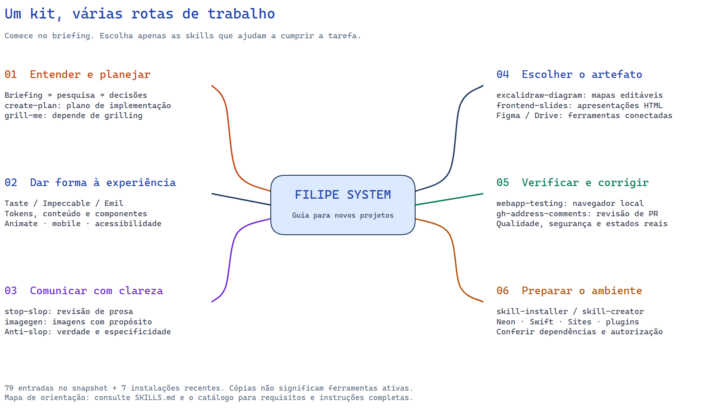

# FILIPE SYSTEM

Biblioteca pessoal para criar experiências digitais com intenção. Snapshot: 30/10/2026.

## Mapa do design guide

[Ampliar o mapa](mapas/filipe-system.png) · [Baixar a versão editável](mapas/filipe-system.excalidraw) · [Escolher uma skill](guias/SKILLS.md)

Mapa mental criado com a skill excalidraw-diagram. Para navegar com zoom, mover elementos e editar os ramos, baixe o arquivo `.excalidraw` e abra-o em [Excalidraw](https://excalidraw.com). Os títulos dos ramos têm links para os documentos no GitHub. A prévia acima é estática; o GitHub não executa um editor interativo dentro do README.

## Comece aqui

1. Preencha [BRIEFING.md](templates/BRIEFING.md).
2. Leia [AGENTS.md](AGENTS.md) e [FLUXO-DE-TRABALHO.md](guias/FLUXO-DE-TRABALHO.md).
3. Leia [como escolher e usar skills](guias/SKILLS.md) e consulte o [catálogo e as instalações recentes](skills/CATALOGO.md); aplique apenas as relevantes.
4. Aplique [ANTI-AI-SLOP.md](guias/ANTI-AI-SLOP.md) e registre decisões e referências nos templates.
5. Execute [QUALIDADE.md](guias/QUALIDADE.md) antes da entrega.

## Estrutura

- `guias/`: design system, pesquisa, imagens, conteúdo, scroll, mouse, loading, segurança, performance e acessibilidade.
- `templates/`: briefing, decisões, pesquisa e inventário de imagens temporárias.
- `skills/projeto/`: 19 skills instaladas neste portfólio, com arquivos de apoio.
- `skills/locais/`: skills locais e de sistema disponíveis.
- `.agents/skills/`: instalações específicas deste projeto; `skills-lock.json` registra as feitas pelo CLI skills.
- `skills/plugins/`: instruções dos plugins da sessão; as ferramentas e contas não são instaladas por esta cópia.
- `referencia-portfolio/`: documentos e tokens originais. Histórico específico, não regras universais.
- `FONTES.md`: fontes e limites de atualização.

## Uso em novos projetos

Copie `guias/` e `templates/` para `docs/filipe-system/` no novo projeto. Adapte o AGENTS.md à estrutura existente. Copie as skills necessárias para `.agents/skills/`, mantendo cada SKILL.md junto com seus arquivos de apoio. Compare versões antes de sobrescrever uma instalação existente.

Prompt inicial:

> Leia o AGENTS.md do projeto e docs/filipe-system/guias/FLUXO-DE-TRABALHO.md. Use o briefing, pesquise referências do setor e documente uma direção visual própria. Aplique as skills relevantes. Implemente, verifique no navegador e informe resultados e limitações. Identifique conteúdo demonstrativo e registre imagens a substituir.

Não carregar toda a biblioteca por padrão. Skills de plugins exigem ferramentas e integrações compatíveis. Revise scripts antes de executar. Preserve atribuições e verifique licenças antes de redistribuir. Este kit é uma cópia local, sem atualização automática.

O pacote original contém 79 entradas de catálogo, com duplicatas entre origens. As instalações globais posteriores ficam em `~/.codex/skills/` e não acompanham este repositório. Consulte o catálogo para distinguir cópias, instalações e dependências pendentes.
